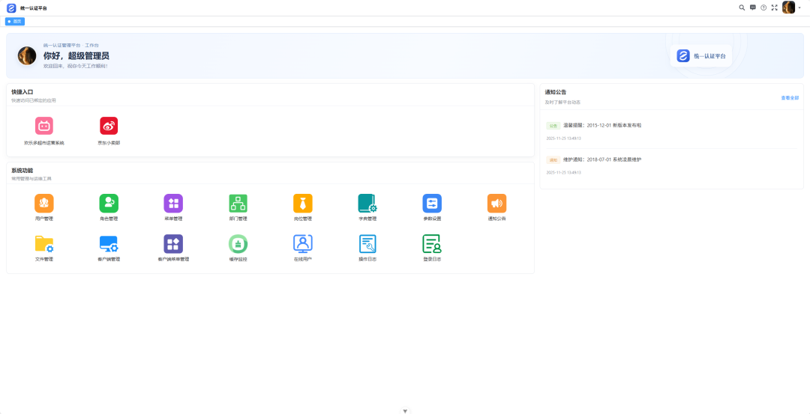
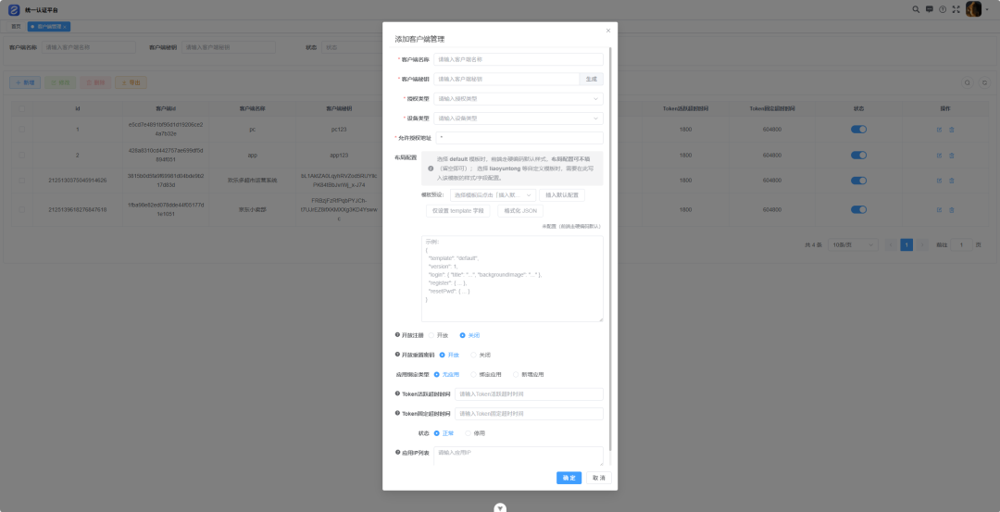
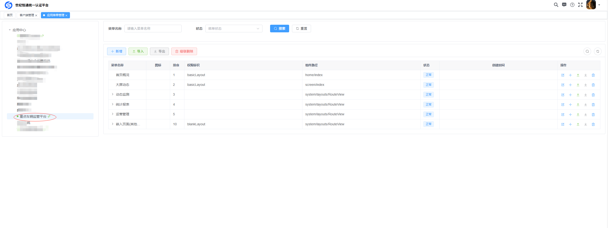
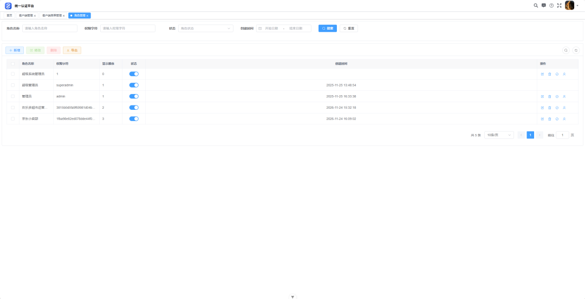
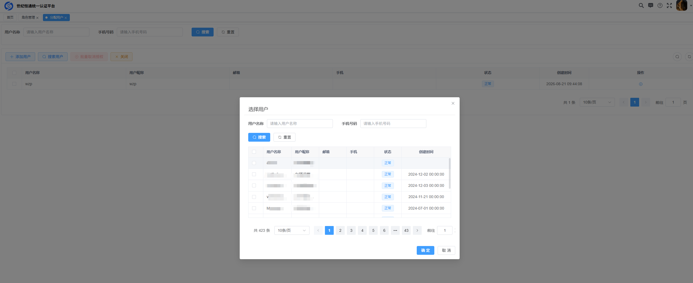
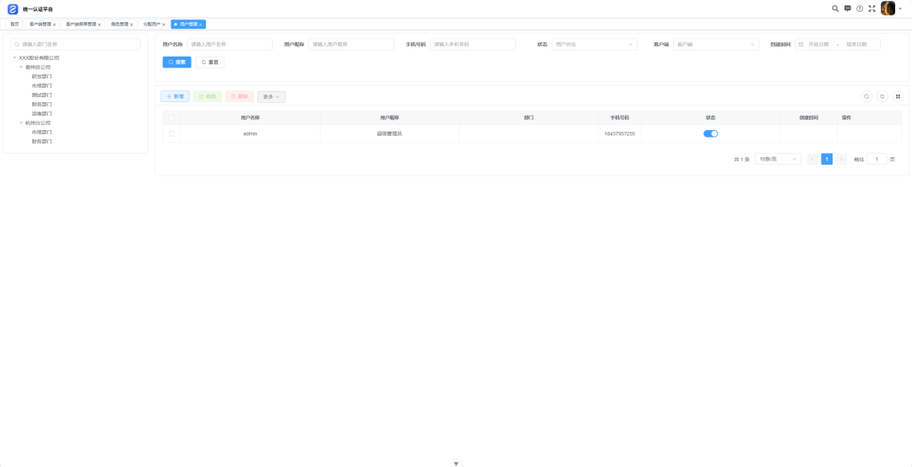

# Cloud Auth Platform

> Chinese version: [README.md](README.md)

This repository combines four related projects:

| Directory | Description |
| --- | --- |
| `backend/` | Spring Cloud authorization and account services |
| `backend-monolith/` | Standalone monolithic backend: merges the auth, system and resource services; no Nacos, Dubbo or gateway. The Docker image is built from this module. |
| `client-oauth/` | Java OAuth/SSO client SDK |
| `frontend/` | Vue administration console |

## Build

- Backend: run `mvn -DskipTests package` from `backend/`.
- Monolith backend: run `mvn -DskipTests package` from `backend-monolith/`.
- OAuth client: run `mvn -DskipTests package` from `client-oauth/`.
- Frontend: copy `frontend/.env.example` to a local Vite environment file, install the dependencies, and run `npm run dev` from `frontend/`.

Configure database, Nacos, OAuth and other deployment credentials through environment-specific configuration. Do not commit credentials, private keys, raw production database exports, or environment files unless they are intentionally part of this repository.

For local deployment, `backend/script/sql/security-cloud.sql` contains the bootstrap data and `backend/script/config/nacos/DEFAULT_GROUP/` contains the configuration files to import into Nacos (`DEFAULT_GROUP`, public namespace).

The backend and frontend are based on the RuoYi ecosystem; retain the upstream notices and licenses included with those components.

## Monolith backend (`backend-monolith/`)

`backend-monolith/` is a fully independent monolithic backend ported from the microservice version in `backend/`. The former `auth`, `system` and `resource` services are merged into one Spring Boot application running in a single JVM, with no code or build dependency on the microservice version.

- No Nacos, Dubbo, Spring Cloud Gateway or Seata: configuration is read from local `application-{local|dev|prod}.yml` files, and frontend API requests are reverse-proxied by nginx to the application port `9215`.
- The database bootstrap script is shared with `backend/script/sql/security-cloud.sql`; no separate SQL or Nacos configuration is maintained.
- The Docker single-container image described below is built from this module.

```bash
cd backend-monolith
mvn -DskipTests package
java -Xms128m -Xmx256m -jar target/cloud-auth-platform-monolith-2.5.1.jar --spring.profiles.active=dev
```

The `local` profile is active by default. For `dev` / `prod`, supply connection details through `MYSQL_*`, `REDIS_*`, `FRONTEND_URL` and other environment variables. See `backend-monolith/README.md` for full configuration details and the nginx reverse-proxy example.

## Docker single-container deployment

The image is published on Docker Hub. A single container runs both `backend-monolith` and the built frontend static assets.

| Image | Description |
| --- | --- |
| `qychan/cloud-auth-platform:2.5.1` | Fixed version, recommended for production |
| `qychan/cloud-auth-platform:latest` | Latest version |
| `sha256:6dce8b949ac626a18f434acd64e1deb9136f3c8fa5a1449606786b5d649ddfb8` | Current digest of `latest` / `2.5.1` |

Inside the container, nginx listens on port `80`. The root path redirects to `/cloudAuthPlatform/`, and `/cloudAuthPlatform/prod-api/` is reverse-proxied to the backend service on `127.0.0.1:9215` inside the container. Only port `80` needs to be published; port `9215` does not need to be exposed separately.

### Prerequisites

1. Prepare MySQL and import `backend/script/sql/security-cloud.sql`.
2. Prepare Redis.
3. MySQL and Redis must be reachable from the container. For a host machine, Docker Desktop can use `host.docker.internal`; on Linux, use the host IP or host networking.
4. Allocate no more than `1g` of memory to the container; the default JVM settings are tuned for a 1G container limit.

### Pull and run

```bash
docker pull qychan/cloud-auth-platform:2.5.1

docker run -d \
  --name cloud-auth-platform \
  --restart unless-stopped \
  -p 80:80 \
  -m 1g --memory-swap 1g \
  -e MYSQL_HOST=192.168.1.10 \
  -e MYSQL_PORT=3306 \
  -e MYSQL_DATABASE=security-cloud \
  -e MYSQL_USERNAME=root \
  -e MYSQL_PASSWORD='your-mysql-password' \
  -e REDIS_HOST=192.168.1.10 \
  -e REDIS_PORT=6379 \
  -e REDIS_DATABASE=4 \
  -e REDIS_PASSWORD='your-redis-password' \
  -e FRONTEND_URL='http://192.168.1.20/cloudAuthPlatform/index.html#' \
  qychan/cloud-auth-platform:2.5.1
```

Then open:

```text
http://<server-ip>/cloudAuthPlatform/
```

### Environment variables

| Variable | Default | Description |
| --- | --- | --- |
| `SPRING_PROFILES_ACTIVE` | `prod` | Spring Boot profile |
| `MYSQL_HOST` | `mysql` | MySQL host |
| `MYSQL_PORT` | `3306` | MySQL port |
| `MYSQL_DATABASE` | `security-cloud` | Database name |
| `MYSQL_USERNAME` | `root` | Database username |
| `MYSQL_PASSWORD` | empty | Database password |
| `REDIS_HOST` | `redis` | Redis host |
| `REDIS_PORT` | `6379` | Redis port |
| `REDIS_DATABASE` | `4` | Redis database index |
| `REDIS_PASSWORD` | empty | Redis password |
| `FRONTEND_URL` | `http://localhost/cloudAuthPlatform/index.html#` | Frontend URL used for third-party login / SSO callbacks |
| `JAVA_XMS` | `64m` | JVM initial heap size |
| `JAVA_XMX` | `256m` | JVM maximum heap size |
| `JAVA_METASPACE` | `128m` | JVM maximum metaspace size |
| `JAVA_CODE_CACHE` | `48m` | JVM code cache size |
| `JAVA_DIRECT_MEMORY` | `96m` | JVM maximum direct memory |
| `JAVA_THREAD_STACK` | `256k` | JVM thread stack size |
| `JAVA_OPTS` | empty | Full override of JVM arguments; when set, the individual `JAVA_*` settings above no longer apply |

### Compose example

```yaml
services:
  cloud-auth-platform:
    image: qychan/cloud-auth-platform:2.5.1
    container_name: cloud-auth-platform
    restart: unless-stopped
    ports:
      - "80:80"
    mem_limit: 1g
    memswap_limit: 1g
    environment:
      MYSQL_HOST: 192.168.1.10
      MYSQL_PORT: 3306
      MYSQL_DATABASE: security-cloud
      MYSQL_USERNAME: root
      MYSQL_PASSWORD: your-mysql-password
      REDIS_HOST: 192.168.1.10
      REDIS_PORT: 6379
      REDIS_DATABASE: 4
      REDIS_PASSWORD: your-redis-password
      FRONTEND_URL: http://192.168.1.20/cloudAuthPlatform/index.html#
```

### Common operations

```bash
docker logs -f cloud-auth-platform
docker ps --filter name=cloud-auth-platform
docker stop cloud-auth-platform
docker rm cloud-auth-platform
```

To build the image from source:

```bash
docker build -f docker/Dockerfile -t cloud-auth-platform:local --pull=false .
```

## Local login account

After importing the SQL bootstrap script and starting the service, you can log in to the admin console with:

- Username: `admin`
- Password: `admin@123`

> This account is intended only for local development and demos. Change the default password before any production deployment.

## Screenshots

### Home



### Client management



### Application menu management



### Role management



### User management



### Department users



## Single sign-on (SSO)

Once a subsystem is integrated, a user only needs to log in once at the central authorization server to access all authorized subsystems. The flow has two steps.

### 1. The subsystem service returns the authorization URL

The subsystem calls its own service endpoint to obtain the authorization server login URL, and the browser navigates to it:

```text
GET http://127.0.0.1/thrid-api/sso/getSsoAuthUrl
```

Optional parameters:

- `clientLoginUrl`: the callback URL that receives the ticket after successful authorization. When empty, the SDK fetches the default URL from the authorization server by `clientId`.
- `back`: the business page to redirect to after login.
- `encrypt`: when `true`, returns the encrypted authorization URL.

Example response (use the `data` field for navigation):

```json
{
  "code": 200,
  "data": "https://auth-server/sso/auth?client=...&redirect=..."
}
```

> `/thrid-api` above is an example subsystem gateway prefix; the SDK's built-in endpoint path is `/sso/getSsoAuthUrl`.

### 2. Use the ticket to complete local login in the subsystem

After successful authorization, the server redirects back to `clientLoginUrl` with a one-time `ticket`. The subsystem then calls:

```text
GET http://127.0.0.1/thrid-api/sso/doLoginByTicket?ticket=u9mB3SzjP6a1IXdqoglsk02Mv9ceP1yFvXiZTzaTkowXkD8pdzLRek6N51FRRNOr
```

The SDK validates and consumes the `ticket`, automatically calls `StpUtil.login()`, fetches the full user profile and returns a `CloudLoginVo`. A ticket is valid only once and cannot be reused.

Built-in SSO endpoints also include:

- `GET /sso/login`: redirect to the authorization server.
- `GET /sso/logout`: single logout, notifying other logged-in applications.

### Homepage shortcuts to client systems

After login, the homepage calls `/system/menu/listBoundApplications` to get the applications bound to the current account and displays them in the shortcuts area. Clicking a card triggers:

```text
POST /auth/sso/getRedirectUrl
Parameters: client=<client-id>&redirect=<application-url>
```

The backend returns a URL carrying the SSO ticket / login state, which the frontend opens in a new window via `window.open(...)`. The user enters client systems without typing credentials again.

## Client SDK integration (`client-oauth/`)

`client-oauth/` is the Java client SDK for the unified authorization platform. Maven coordinates:

```xml
<dependency>
    <groupId>io.gitee.chenshaogui.cloudauth</groupId>
    <artifactId>cloud-auth-client-oauth</artifactId>
    <version>1.5.11</version>
</dependency>
```

Capabilities:

| Capability | Description |
| --- | --- |
| Unified login | Redirect to the authorization server and complete local `StpUtil.login()` via `ticket` |
| User state access | `CloudPlatformHelper.getLoginUser()` / `getUserId()` with O(1) in-memory reads |
| Unified logout | Cross-subsystem single logout and current-system logout |
| Shared data | Departments / dictionaries / parameters / regions / notices / OSS files with remote fetch and multi-level caching |
| Permission sync | Menu / role changes on the server are detected by clients and refresh the session |
| Operation logs | Business threads report to the authorization center `sys_oper_log` in O(1) |
| Allowlist | `sa-token.permit-paths` configures login-free URLs (Ant patterns) |

Minimal configuration:

```yaml
sa-token:
  token-name: Authorization
  token-prefix: Bearer
  token-style: random-32
  sso-client:
    client: <client-id assigned by the authorization center>
    secret-key: <client secret key>
    server-url: http://127.0.0.1/thrid-api
    auth-url: http://127.0.0.1/cloudAuthPlatform/#/ssologin
    is-http: true
  permit-paths:
    - /sso/**
  expose-controller: true
```

> Client tokens are signed in JWT mode and the key must match the authorization server. Do not commit real keys to the repository in production.

For all configuration options, built-in endpoints and utilities, see `client-oauth/doc/统一授权平台-开发者使用手册.md`.
