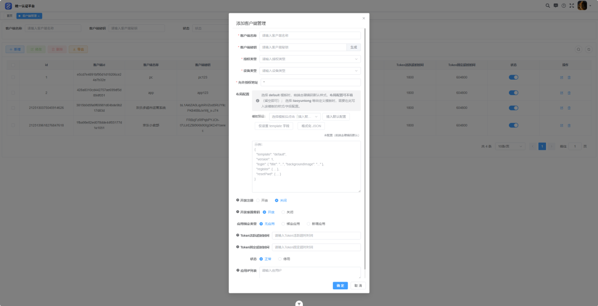

# Cloud Auth Platform

This repository combines three related projects:

| Directory | Description |
| --- | --- |
| `backend/` | Spring Cloud authorization and account services |
| `client-oauth/` | Java OAuth/SSO client SDK |
| `frontend/` | Vue administration console |

## Build

- Backend: run `mvn -DskipTests package` from `backend/`.
- OAuth client: run `mvn -DskipTests package` from `client-oauth/`.
- Frontend: copy `frontend/.env.example` to a local Vite environment file, install the dependencies, and run `npm run dev` from `frontend/`.

Configure database, Nacos, OAuth and other deployment credentials through environment-specific configuration. Do not commit credentials, private keys, raw production database exports, or environment files unless they are intentionally part of this repository.

For local deployment, `backend/script/sql/security-cloud.sql` contains the bootstrap data and `backend/script/config/nacos/DEFAULT_GROUP/` contains the configuration files to import into Nacos (`DEFAULT_GROUP`, public namespace).

The backend and frontend are based on the RuoYi ecosystem; retain the upstream notices and licenses included with those components.

## 本地登录账号

导入上述 SQL 初始化脚本并启动服务后，可使用以下账号登录管理后台：

- 用户名：`admin`
- 密码：`admin@123`

> 该账号仅用于本地开发和演示，部署到生产环境前请务必修改默认密码。

## 页面展示

### 首页


### 客户端管理



### 应用菜单管理


### 角色管理


### 用户管理


### 部门用户


## 单点登录（SSO）

子系统接入后，用户只需在统一授权中心登录一次，即可访问所有已授权子系统。完整链路分两步：

### 1. 子系统服务接口返回授权中心地址

子系统调用自己的服务接口获取授权中心登录地址，浏览器跳转到该地址完成登录：

```text
GET http://127.0.0.1/thrid-api/sso/getSsoAuthUrl
```

可选参数：

- `clientLoginUrl`：授权成功后的票据投递地址；为空时由 SDK 按 `clientId` 从授权中心拉取默认地址。
- `back`：登录成功后再次回跳的业务页面。
- `encrypt`：为 `true` 时返回密文版授权地址。

返回示例（取 `data` 字段跳转）：

```json
{
  "code": 200,
  "data": "https://授权中心/sso/auth?client=...&redirect=..."
}
```

> 上面的 `/thrid-api` 是子系统网关前缀示例；SDK 内置的接口路径是 `/sso/getSsoAuthUrl`。

### 2. 使用 ticket 完成子系统本地登录

授权中心登录成功后会向 `clientLoginUrl` 回跳并携带一次性 `ticket`。子系统服务再调用：

```text
GET http://127.0.0.1/thrid-api/sso/doLoginByTicket?ticket=u9mB3SzjP6a1IXdqoglsk02Mv9ceP1yFvXiZTzaTkowXkD8pdzLRek6N51FRRNOr
```

SDK 会校验并消费该 `ticket`，自动完成 `StpUtil.login()`、拉取用户全量数据并返回 `CloudLoginVo`。`ticket` 一次性有效，不能重复使用。

内置 SSO 接口还包括：

- `GET /sso/login`：跳转到授权中心。
- `GET /sso/logout`：单点注销，通知授权中心踢下线其他已登录应用。

### 首页快捷入口直接跳转客户端系统

登录后的首页会调用 `/system/menu/listBoundApplications` 获取当前账号已绑定、可访问的应用，展示在“快捷入口”区域。点击卡片时前端调用：

```text
POST /auth/sso/getRedirectUrl
参数：client=<客户端ID>&redirect=<应用地址>
```

后端返回带 SSO 票据/登录态的客户端地址，前端用 `window.open(...)` 新窗口打开，用户无需再次输入用户名密码即可进入客户端系统。

## 客户端 SDK 集成（`client-oauth/`）

`client-oauth/` 是统一鉴权平台的 Java 客户端 SDK，构件坐标：

```xml
<dependency>
    <groupId>io.gitee.chenshaogui.cloudauth</groupId>
    <artifactId>cloud-auth-client-oauth</artifactId>
    <version>1.5.11</version>
</dependency>
```

SDK 提供以下能力：

| 能力 | 说明 |
| --- | --- |
| 统一登录 | 跳转授权中心登录，通过 `ticket` 完成本地 `StpUtil.login()` |
| 用户态读取 | `CloudPlatformHelper.getLoginUser()` / `getUserId()` 等，O(1) 内存读取 |
| 统一注销 | 跨子系统单点注销 / 当前系统单独注销 |
| 公共数据 | 部门 / 字典 / 参数 / 区域 / 公告 / OSS 文件，远程拉取 + 多级缓存 |
| 权限同步 | 服务端改菜单 / 改角色后，客户端自动感知并刷新 Session |
| 操作日志 | 业务线程 O(1) 上报到鉴权中心 `sys_oper_log` |
| 白名单 | `sa-token.permit-paths` 配置免登录 URL（Ant 模式） |

最小配置示例：

```yaml
sa-token:
  token-name: Authorization
  token-prefix: Bearer
  token-style: random-32
  sso-client:
    client: <统一授权中心分配的客户端ID>
    secret-key: <客户端秘钥>
    server-url: http://127.0.0.1/thrid-api
    auth-url: http://127.0.0.1/cloudAuthPlatform/#/ssologin
    is-http: true
  permit-paths:
    - /sso/**
  expose-controller: true
```

> 客户端 token 使用 JWT 模式签发，密钥必须与鉴权中心一致；生产环境不要在仓库中提交真实密钥。

完整配置项、内置接口和工具类说明参见 `client-oauth/doc/统一授权平台-开发者使用手册.md`。
