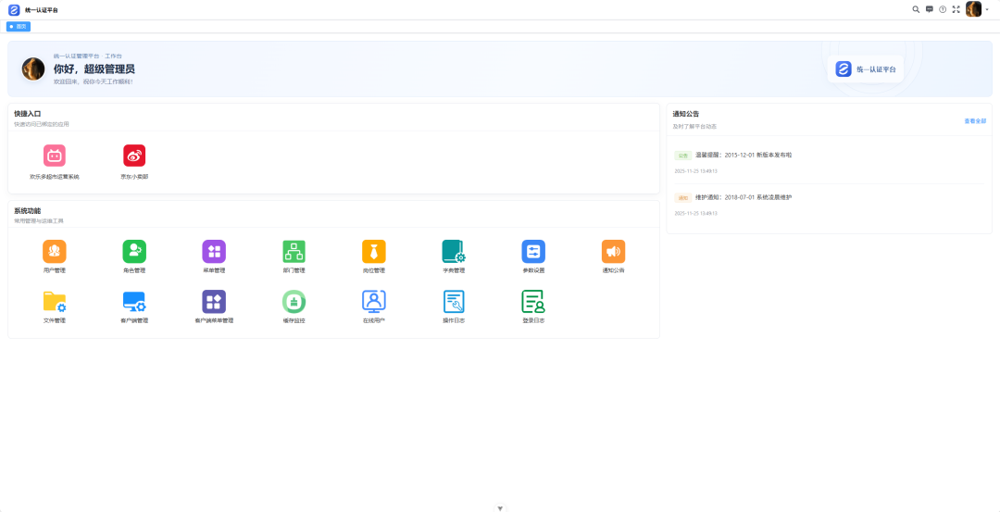
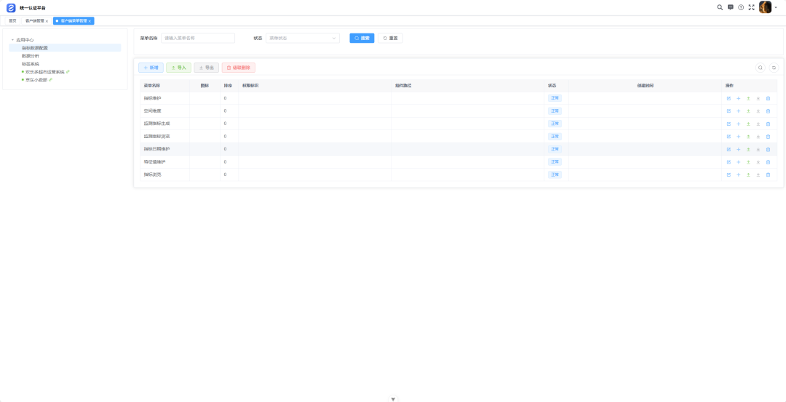
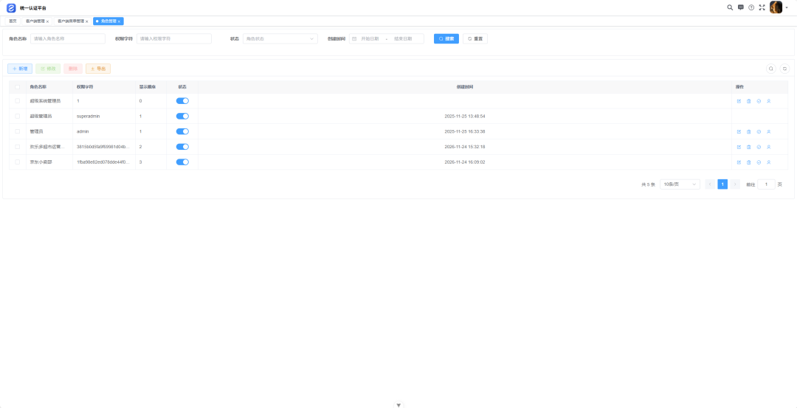
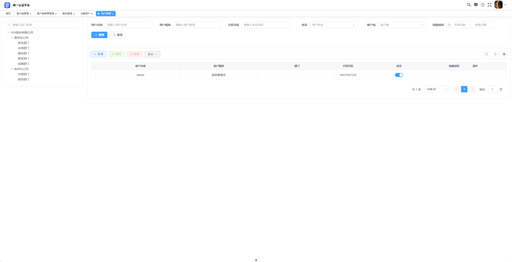

# Cloud Auth Platform

This repository combines three related projects:

| Directory | Description |
| --- | --- |
| `backend/` | Spring Cloud authorization and account services |
| `client-oauth/` | Java OAuth/SSO client SDK |
| `frontend/` | Vue administration console |

## Build

- Backend: run `mvn -DskipTests package` from `backend/`.
- OAuth client: run `mvn -DskipTests package` from `client-oauth/`.
- Frontend: copy `frontend/.env.example` to a local Vite environment file, install the dependencies, and run `npm run dev` from `frontend/`.

Configure database, Nacos, OAuth and other deployment credentials through environment-specific configuration. Do not commit credentials, private keys, raw production database exports, or environment files unless they are intentionally part of this repository.

For local deployment, `backend/script/sql/security-cloud.sql` contains the bootstrap data and `backend/script/config/nacos/DEFAULT_GROUP/` contains the configuration files to import into Nacos (`DEFAULT_GROUP`, public namespace).

The backend and frontend are based on the RuoYi ecosystem; retain the upstream notices and licenses included with those components.

## 页面展示

### 首页

### 客户端管理

### 应用菜单管理

### 角色管理

### 用户管理

### 部门用户

