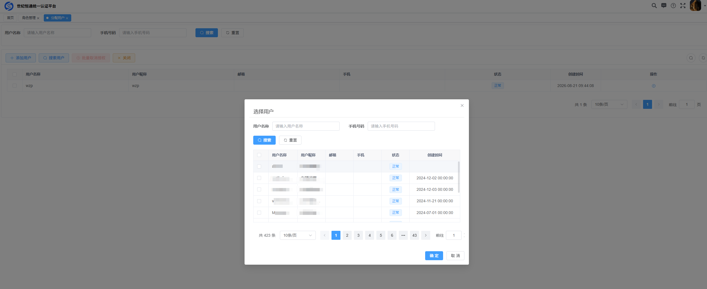

# Cloud Auth Platform

This repository combines three related projects:

| Directory | Description |
| --- | --- |
| `backend/` | Spring Cloud authorization and account services |
| `client-oauth/` | Java OAuth/SSO client SDK |
| `frontend/` | Vue administration console |

## Build

- Backend: run `mvn -DskipTests package` from `backend/`.
- OAuth client: run `mvn -DskipTests package` from `client-oauth/`.
- Frontend: copy `frontend/.env.example` to a local Vite environment file, install the dependencies, and run `npm run dev` from `frontend/`.

Configure database, Nacos, OAuth and other deployment credentials through environment-specific configuration. Do not commit credentials, private keys, raw production database exports, or environment files unless they are intentionally part of this repository.

For local deployment, `backend/script/sql/security-cloud.sql` contains the bootstrap data and `backend/script/config/nacos/DEFAULT_GROUP/` contains the configuration files to import into Nacos (`DEFAULT_GROUP`, public namespace).

The backend and frontend are based on the RuoYi ecosystem; retain the upstream notices and licenses included with those components.

## Docker 单容器部署

镜像已发布到 Docker Hub，单个容器同时运行 `backend-monolith` 和已构建的前端静态资源：

| 镜像 | 说明 |
| --- | --- |
| `qychan/cloud-auth-platform:2.5.1` | 固定版本，推荐生产环境使用 |
| `qychan/cloud-auth-platform:latest` | 最新版本 |
| `sha256:c608d9277e832eb1121f200c4f9abe72af451f73ae9e29a49a33823a725d681e` | `latest` / `2.5.1` 当前对应 digest |

镜像内 nginx 监听 `80` 端口，根路径会重定向到 `/cloudAuthPlatform/`；`/cloudAuthPlatform/prod-api/` 会反向代理到容器内 `127.0.0.1:9215` 的后端服务。部署时只需映射容器 `80` 端口，无需单独暴露 `9215`。

### 前置条件

1. 已准备好 MySQL，并导入 `backend/script/sql/security-cloud.sql`。
2. 已准备好 Redis。
3. MySQL 和 Redis 必须能够从该容器访问；如果部署在宿主机上，Docker Desktop 可使用 `host.docker.internal`，Linux 可填写宿主机 IP 或使用 host 网络。
4. 建议为容器分配不超过 `1g` 内存；镜像默认 JVM 参数已按 1G 容器限制调优。

### 拉取并启动

```bash
docker pull qychan/cloud-auth-platform:2.5.1

docker run -d \
  --name cloud-auth-platform \
  --restart unless-stopped \
  -p 80:80 \
  -m 1g --memory-swap 1g \
  -e MYSQL_HOST=192.168.1.10 \
  -e MYSQL_PORT=3306 \
  -e MYSQL_DATABASE=security-cloud \
  -e MYSQL_USERNAME=root \
  -e MYSQL_PASSWORD='your-mysql-password' \
  -e REDIS_HOST=192.168.1.10 \
  -e REDIS_PORT=6379 \
  -e REDIS_DATABASE=4 \
  -e REDIS_PASSWORD='your-redis-password' \
  -e FRONTEND_URL='http://192.168.1.20/cloudAuthPlatform/index.html#' \
  qychan/cloud-auth-platform:2.5.1
```

启动后访问：

```text
http://服务器IP/cloudAuthPlatform/
```

### 环境变量

| 变量 | 默认值 | 说明 |
| --- | --- | --- |
| `SPRING_PROFILES_ACTIVE` | `prod` | Spring Boot profile |
| `MYSQL_HOST` | `mysql` | MySQL 主机 |
| `MYSQL_PORT` | `3306` | MySQL 端口 |
| `MYSQL_DATABASE` | `security-cloud` | 数据库名 |
| `MYSQL_USERNAME` | `root` | 数据库用户名 |
| `MYSQL_PASSWORD` | 空 | 数据库密码 |
| `REDIS_HOST` | `redis` | Redis 主机 |
| `REDIS_PORT` | `6379` | Redis 端口 |
| `REDIS_DATABASE` | `4` | Redis 数据库序号 |
| `REDIS_PASSWORD` | 空 | Redis 密码 |
| `FRONTEND_URL` | `http://localhost/cloudAuthPlatform/index.html#` | 第三方登录 / SSO 回调使用的前端地址 |
| `JAVA_XMS` | `64m` | JVM 初始堆 |
| `JAVA_XMX` | `256m` | JVM 最大堆 |
| `JAVA_METASPACE` | `128m` | JVM 最大元空间 |
| `JAVA_CODE_CACHE` | `48m` | JVM 代码缓存 |
| `JAVA_DIRECT_MEMORY` | `96m` | JVM 最大直接内存 |
| `JAVA_THREAD_STACK` | `256k` | JVM 线程栈大小 |
| `JAVA_OPTS` | 空 | 完整覆盖 JVM 参数；设置后上述 `JAVA_*` 拆分参数不再生效 |

### Compose 示例

```yaml
services:
  cloud-auth-platform:
    image: qychan/cloud-auth-platform:2.5.1
    container_name: cloud-auth-platform
    restart: unless-stopped
    ports:
      - "80:80"
    mem_limit: 1g
    memswap_limit: 1g
    environment:
      MYSQL_HOST: 192.168.1.10
      MYSQL_PORT: 3306
      MYSQL_DATABASE: security-cloud
      MYSQL_USERNAME: root
      MYSQL_PASSWORD: your-mysql-password
      REDIS_HOST: 192.168.1.10
      REDIS_PORT: 6379
      REDIS_DATABASE: 4
      REDIS_PASSWORD: your-redis-password
      FRONTEND_URL: http://192.168.1.20/cloudAuthPlatform/index.html#
```

### 常用运维命令

```bash
docker logs -f cloud-auth-platform
docker ps --filter name=cloud-auth-platform
docker stop cloud-auth-platform
docker rm cloud-auth-platform
```

如需从源码自行构建镜像：

```bash
docker build -f docker/Dockerfile -t cloud-auth-platform:local --pull=false .
```

## 本地登录账号

导入上述 SQL 初始化脚本并启动服务后，可使用以下账号登录管理后台：

- 用户名：`admin`
- 密码：`admin@123`

> 该账号仅用于本地开发和演示，部署到生产环境前请务必修改默认密码。

## 页面展示

### 首页


### 客户端管理


### 应用菜单管理


### 角色管理


### 用户管理



### 部门用户


## 单点登录（SSO）

子系统接入后，用户只需在统一授权中心登录一次，即可访问所有已授权子系统。完整链路分两步：

### 1. 子系统服务接口返回授权中心地址

子系统调用自己的服务接口获取授权中心登录地址，浏览器跳转到该地址完成登录：

```text
GET http://127.0.0.1/thrid-api/sso/getSsoAuthUrl
```

可选参数：

- `clientLoginUrl`：授权成功后的票据投递地址；为空时由 SDK 按 `clientId` 从授权中心拉取默认地址。
- `back`：登录成功后再次回跳的业务页面。
- `encrypt`：为 `true` 时返回密文版授权地址。

返回示例（取 `data` 字段跳转）：

```json
{
  "code": 200,
  "data": "https://授权中心/sso/auth?client=...&redirect=..."
}
```

> 上面的 `/thrid-api` 是子系统网关前缀示例；SDK 内置的接口路径是 `/sso/getSsoAuthUrl`。

### 2. 使用 ticket 完成子系统本地登录

授权中心登录成功后会向 `clientLoginUrl` 回跳并携带一次性 `ticket`。子系统服务再调用：

```text
GET http://127.0.0.1/thrid-api/sso/doLoginByTicket?ticket=u9mB3SzjP6a1IXdqoglsk02Mv9ceP1yFvXiZTzaTkowXkD8pdzLRek6N51FRRNOr
```

SDK 会校验并消费该 `ticket`，自动完成 `StpUtil.login()`、拉取用户全量数据并返回 `CloudLoginVo`。`ticket` 一次性有效，不能重复使用。

内置 SSO 接口还包括：

- `GET /sso/login`：跳转到授权中心。
- `GET /sso/logout`：单点注销，通知授权中心踢下线其他已登录应用。

### 首页快捷入口直接跳转客户端系统

登录后的首页会调用 `/system/menu/listBoundApplications` 获取当前账号已绑定、可访问的应用，展示在“快捷入口”区域。点击卡片时前端调用：

```text
POST /auth/sso/getRedirectUrl
参数：client=<客户端ID>&redirect=<应用地址>
```

后端返回带 SSO 票据/登录态的客户端地址，前端用 `window.open(...)` 新窗口打开，用户无需再次输入用户名密码即可进入客户端系统。

## 客户端 SDK 集成（`client-oauth/`）

`client-oauth/` 是统一鉴权平台的 Java 客户端 SDK，构件坐标：

```xml
<dependency>
    <groupId>io.gitee.chenshaogui.cloudauth</groupId>
    <artifactId>cloud-auth-client-oauth</artifactId>
    <version>1.5.11</version>
</dependency>
```

SDK 提供以下能力：

| 能力 | 说明 |
| --- | --- |
| 统一登录 | 跳转授权中心登录，通过 `ticket` 完成本地 `StpUtil.login()` |
| 用户态读取 | `CloudPlatformHelper.getLoginUser()` / `getUserId()` 等，O(1) 内存读取 |
| 统一注销 | 跨子系统单点注销 / 当前系统单独注销 |
| 公共数据 | 部门 / 字典 / 参数 / 区域 / 公告 / OSS 文件，远程拉取 + 多级缓存 |
| 权限同步 | 服务端改菜单 / 改角色后，客户端自动感知并刷新 Session |
| 操作日志 | 业务线程 O(1) 上报到鉴权中心 `sys_oper_log` |
| 白名单 | `sa-token.permit-paths` 配置免登录 URL（Ant 模式） |

最小配置示例：

```yaml
sa-token:
  token-name: Authorization
  token-prefix: Bearer
  token-style: random-32
  sso-client:
    client: <统一授权中心分配的客户端ID>
    secret-key: <客户端秘钥>
    server-url: http://127.0.0.1/thrid-api
    auth-url: http://127.0.0.1/cloudAuthPlatform/#/ssologin
    is-http: true
  permit-paths:
    - /sso/**
  expose-controller: true
```

> 客户端 token 使用 JWT 模式签发，密钥必须与鉴权中心一致；生产环境不要在仓库中提交真实密钥。

完整配置项、内置接口和工具类说明参见 `client-oauth/doc/统一授权平台-开发者使用手册.md`。
